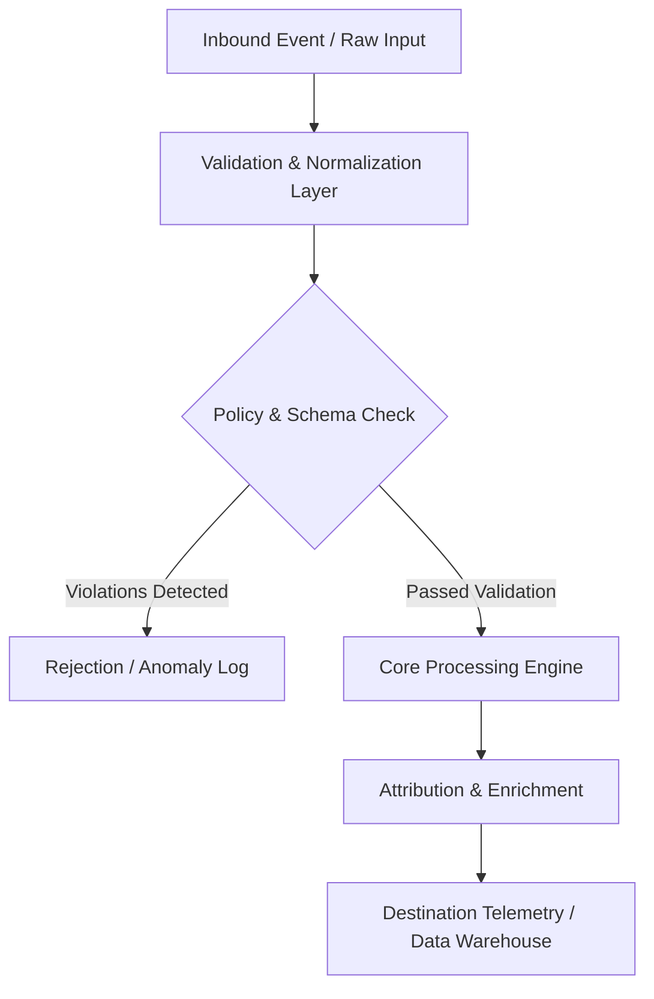

# 12 Slide Executive Deck Blueprint

## Architecture Specification: Client Monthly Growth Report Automation Spec & Deck PRD
This document defines the technical architecture and event flow for **Client Monthly Growth Report Automation Spec & Deck PRD** within the **reporting** domain.

### Operational Context
Build an open-source client monthly growth reporting system: 1) System architecture PRD detailing automated ETL data aggregation from Meta, Google, and GA4, 2) 12-slide executive deck narrative framework (Executive Summary, Blended ROAS, Channel Breakdown, Top Winning Creatives, What Worked / What Didn't, Next Month Action Plan), 3) Python summary compiler (`compile_report.py`).

---

## System Architecture & Data Flow

## Functional Components

### 1. Ingestion & Normalization Layer
- Captures raw telemetry, webhooks, or file exports.
- Strips whitespace, normalizes regional casing, and sanitizes phone numbers and email strings into E.164 and SHA-256 formats.

### 2. Processing & Business Logic Rules
- Applies deterministic rule engines or statistical models without external black-box dependencies.
- Handles missing or delayed event attributes using bounded lookback windows.

### 3. Output Delivery & Error Handling
- Returns structured JSON payloads with machine-readable error codes and status telemetry.
- Employs exponential backoff retry logic (3 attempts: 1s, 5s, 15s) for downstream webhook delivery.

---
*Operational standard maintained by @mahmoudabdelnaby1.*
